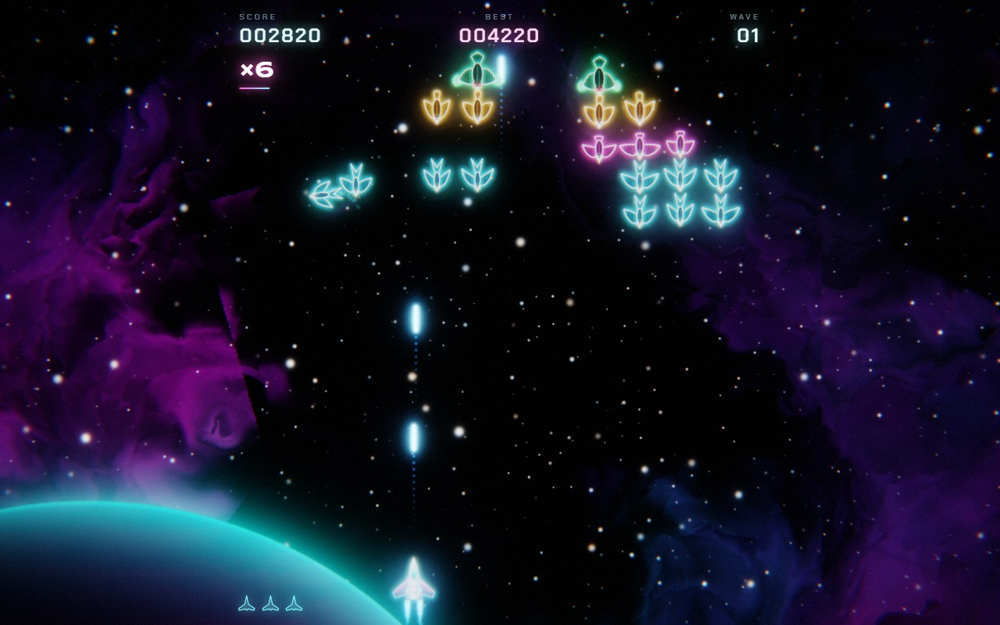

# Nightflock — Claude version

A formation shooter built with Claude (Anthropic), in the genre of *Galaxian* but with
its own theme: a flock of birds holds formation in the night sky, and one bird after
another peels off to dive at your ship. Shoot them down before they reach you.

Graphics and sound are generated in the browser (WebGL 2 and Web Audio). There are no
image or audio files and no libraries.

**[Play it in your browser](https://iago-swi.github.io/galaxian/Claude/)**

The version number is shown on the title screen. The [changelog](CHANGELOG.md) lists
what changed in each version.

## Run it

Play online with the link above. To play offline, download [Nightflock.html](https://raw.githubusercontent.com/iago-swi/galaxian/main/Claude/Nightflock.html),
save it as an HTML file and open it in a current version of Chrome, Edge, Firefox or
Safari. That single file contains the whole game. To work on the source, clone the
repository and open this folder's `index.html`. No installation, build step or web
server is needed. The two typefaces load from Google Fonts; without an internet
connection the game falls back to system fonts.

## How to play

The flock sways at the top of the screen. Every moment or so a bird leaves the
formation, loops round and dives at you, dropping glowing shots on the way. A bird
that misses flies off the bottom of the screen and returns to its place. Clear the
whole flock to jump to the next wave.

| Key | Action |
| --- | --- |
| `←` `→` or `A` `D` | Move |
| `Space` (or `↑`, `W`) | Fire. Hold it to keep firing |
| `Enter` or `Space` | Start, and start again after a game |
| `P` or `Esc` | Pause |
| `M` | Sound on/off |

With a mouse or on a touch screen, press and hold: the ship follows the pointer and
fires.

| Bird | Points | Behavior |
| --- | --- | --- |
| Swallow (cyan) | 30 | Weaves from side to side as it dives. |
| Gull (magenta) | 50 | Turns sharply toward the ship. |
| Falcon (gold) | 80 | The fastest. Dives almost straight. |
| Raven (green, red eyes) | 150 | Takes two hits. Dives with up to two escorts. |

A bird shot while it dives scores double. Kills in quick succession build a chain:
every third kill raises the multiplier by one, up to ×8, and the chain lapses 2.6
seconds after the last kill. Clearing a wave adds 500 points times the wave number.

A raven often drops a power-up when it falls, and a diving bird sometimes does.
Fly through it to pick it up.

| Power-up | Effect |
| --- | --- |
| Twin | Two shots side by side, for 14 seconds. |
| Rapid | Fires twice as fast, with more shots in the air, for 12 seconds. |
| Shield | Absorbs one hit. |

You start with three ships. An extra ship comes at 15,000 points and then every
20,000 points, up to five. After a ship is lost, the next one cannot be hit for 2.6
seconds. A lost ship also loses its power-ups and the chain. The best score is kept
in the browser.

## Technical notes

### Stack

| | |
| --- | --- |
| Delivery | `index.html` plus four scripts in `js/`, about 1450 lines (75 KB) in total. `Nightflock.html` is the same game with the scripts inlined. No dependencies, no build step. |
| Language | Plain JavaScript (ES2020) in classic scripts, no framework. |
| Rendering | WebGL 2 (GLSL ES 3.00) for the whole scene and post-processing. HTML and CSS for the score bar, banners and screens. |
| Sound | Web Audio API. Every sound is synthesized; there are no audio files. |
| Type | Syncopate and Chakra Petch from Google Fonts, with system fallbacks. |
| Storage | `localStorage` only: `nightflock.best` (the best score). |
| Version | Written once, in `index.html` (the line shown on the title screen). Each version has a section in [CHANGELOG.md](CHANGELOG.md), a tag `nightflock-v…` and a release on GitHub; the rules are in [VERSIONING.md](../VERSIONING.md). |
| Requirements | A browser with WebGL 2. `EXT_color_buffer_float` is used for HDR render targets when present; otherwise the game falls back to 8-bit targets. |

| File | Responsibility |
| --- | --- |
| [js/gfx.js](js/gfx.js) | All shaders, render targets, the sprite batch and the frame pipeline. |
| [js/art.js](js/art.js) | Paints every sprite into one texture atlas when the game loads. |
| [js/sfx.js](js/sfx.js) | Sound effects and the soundtrack. |
| [js/game.js](js/game.js) | Formations, bird behavior, the ship, shots, scoring, particles, input, score bar and the frame loop. |
| [index.html](index.html) | Markup and CSS for the title, score bar, banners, pause and game-over screens. |
| [Nightflock.html](Nightflock.html) | Portable single-file edition. |
| [CHANGELOG.md](CHANGELOG.md) | What changed in each version. |

### The birds

No bird is an image file. When the game loads, `js/art.js` paints all sprites with
the Canvas 2D API into one 2048 × 2048 atlas, at twice their size on the playfield,
and uploads it as a texture with mipmaps.

The four species share one painting routine. Each is seen from above, beak pointing
down the screen, and is described by about 25 numbers: wingspan, where the wrist
bends, how far the tips sweep back, the number of feathers on the trailing edge, the
tail shape (forked, fan or wedge), body and head sizes and the colors. The raven adds
five splayed finger feathers at each wing tip. The trailing edge of a wing is a
quadratic curve cut into one scallop per feather.

A wingbeat is four frames. Seen from above, a raised wing looks shorter, so the
routine shrinks the wingspan by 22 to 32% and sweeps the tips back. Each species
beats at its own rate, from 6.5 frames per second for the raven to 13 for the
swallow.

Bodies and wings are nearly black and opaque. The wing fill stays dark for the inner
62 to 78% of the span and fades to color only at the tips; the outline is a thin
bright stroke. A soft glow in the species color is drawn behind each bird, and the
dark body blocks it, which gives the backlit silhouette.

### Formation and dives

The playfield is a fixed 800 × 900 space, scaled to fit the window and centered. A
wave is a grid of slots, 56 wide and 50 high, described by rows of letters. There are
five formations, used in turn.

At the start of a wave the birds fly in from both sides, 75 ms apart, along cubic
Bézier curves that end at their slots. The whole formation sways 62 units to either
side and widens and narrows by 5%.

A dive has two phases. The bird first turns through half a loop away from the
formation, then steers toward the ship with a limited turn rate, on top of a
side-to-side weave whose size depends on the species. Once it is within 150 units
above the ship it stops steering, so a dive can be dodged at the last moment. A bird
that leaves the screen reappears at the top and flies back to its slot. When five
birds or fewer are left, they stop returning and dive again at once.

The next diver is drawn from the eight free birds closest to the edges and the bottom
of the formation. A raven takes the two nearest birds of other species with it, if
they are within 150 units.

| | Swallow | Gull | Falcon | Raven |
| --- | --- | --- | --- | --- |
| Dive speed (units per second) | 235 | 295 | 360 | 255 |
| Turn rate (radians per second) | 2.2 | 3.0 | 1.6 | 2.4 |
| Shots per dive | 1 | 1 | 2 | 3 |
| Hit radius | 15 | 17 | 15 | 24 |

### Difficulty and scoring

| | Wave 1 | Later |
| --- | --- | --- |
| Birds diving at once, at most | 2 | +1 every second wave, up to 7 |
| Pause between dives | 0.9 to 2.4 s | Shorter each wave, down to 0.2 to 0.6 s from wave 12 |
| Dive speed | As in the table above | +4.5% per wave, up to wave 13 |
| Speed of a bird's shot (units per second) | 311 | +11 per wave, up to 450 |
| Shots per dive | As in the table above | One more from wave 6 |

The ship may have three shots in the air, six with Rapid, and twice that with Twin.
A power-up drops from three ravens in four and from one diving bird in twenty, and
picking one up scores 100. Running into a bird costs a ship and counts as one hit on
the bird.

### Rendering pipeline

Everything on the playfield is a textured quad from the atlas. Up to 14,000 quads are
written into one vertex buffer and drawn with a single call, in painter's order.
Blending is premultiplied (`ONE, ONE_MINUS_SRC_ALPHA`) and each quad carries an
"additive" value that scales its alpha: with alpha 0 a quad adds light, with alpha 1
it covers what is behind. Glows, sparks and the dark body of a bird go through the
same draw call.

Each frame runs these passes:

1. **Nebula**, at half resolution. Five-octave value noise, domain-warped twice, and
   colored from a cosine palette. One hue number shifts the palette from wave to
   wave.
2. **Background**, at full resolution. The nebula, three layers of stars that scroll
   at different speeds, and the limb of a planet with banded clouds and a glowing
   atmosphere. Between waves the stars stretch into streaks.
3. **Sprites**, into the same target, a 16-bit float texture where colors may be
   brighter than white.
4. **Bloom.** A soft threshold (0.62), then six levels of downsampling and additive
   upsampling.
5. **Final grade.** Up to eight shockwave distortions, chromatic aberration, a
   vignette, the ACES tone curve and film grain.

Particles live in a ring buffer of 6000 entries, stored as typed arrays. A spark is
drawn as the soft glow sprite stretched along its velocity.

When a ship is lost, time slows to 16% and recovers over about a second, a large
shockwave bends the picture, and the color channels split for a moment.

The render resolution follows the device pixel ratio up to 2 and is capped at
2560 × 1440 pixels.

### Sound

A sequencer schedules sixteenth notes a quarter of a second ahead, polled every
60 ms, at about 103 beats per minute. The harmony is one bar each of A minor, F, C
and G. A pad of four detuned sawtooth oscillators and a sawtooth bass play
throughout; during play a kick, a noise hi-hat and a snare-like burst join in, with
random arpeggio notes through a feedback delay (0.36 s).

Each effect is a short recipe: the ship's shot is two oscillators whose pitch falls,
an explosion is white noise through a low-pass filter that sweeps down, and a dive is
a falling sine tone with a 17 Hz wobble.

### Title screen

The flock behind the title is the real game without a ship: the birds fly in, hold
formation and dive, but do not shoot.

### Behavior

- The game pauses when the window loses focus. While paused, nothing moves and
  nothing is added to the picture.
- Movement is multiplied by the time since the last frame, so the game plays at the
  same speed at 60 and at 120 frames per second.
- With `prefers-reduced-motion`, the title shimmer and the blinking prompts stop. The
  effects on the playfield (shake, shockwaves, color split) are not reduced.
- The best score of the game played online and of a downloaded `Nightflock.html` are
  kept separately, because a browser stores data per address.

### Testing

The game was checked in Chrome with a script that starts a game, holds the fire key
and moves the ship at random: flying in, dives, wave change, power-ups, the extra
ship, pause, game over, starting again and the saved best score. On an Intel Arc 140V
graphics chip at 1280 × 800 it ran at a steady 120 frames per second. The single-file
edition was checked the same way, served from a local web server. Both screenshots
were taken from such runs.

Not checked: sound by ear, play on a real touch screen, opening the files directly
from disk, frame rate on slower graphics hardware, and how hard the later waves are
for a human player.

[Game history and the other versions](../README.md)
