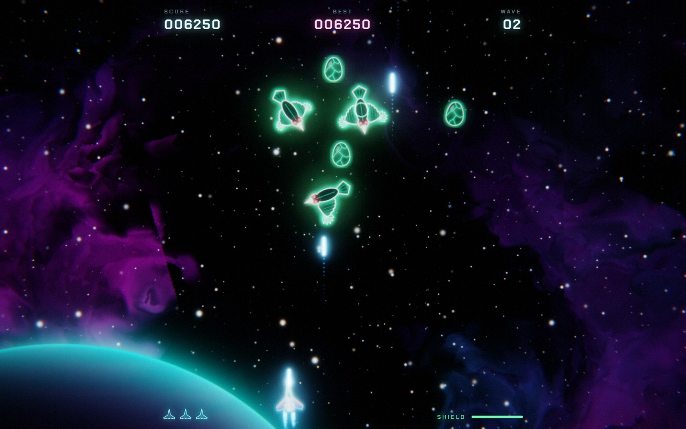
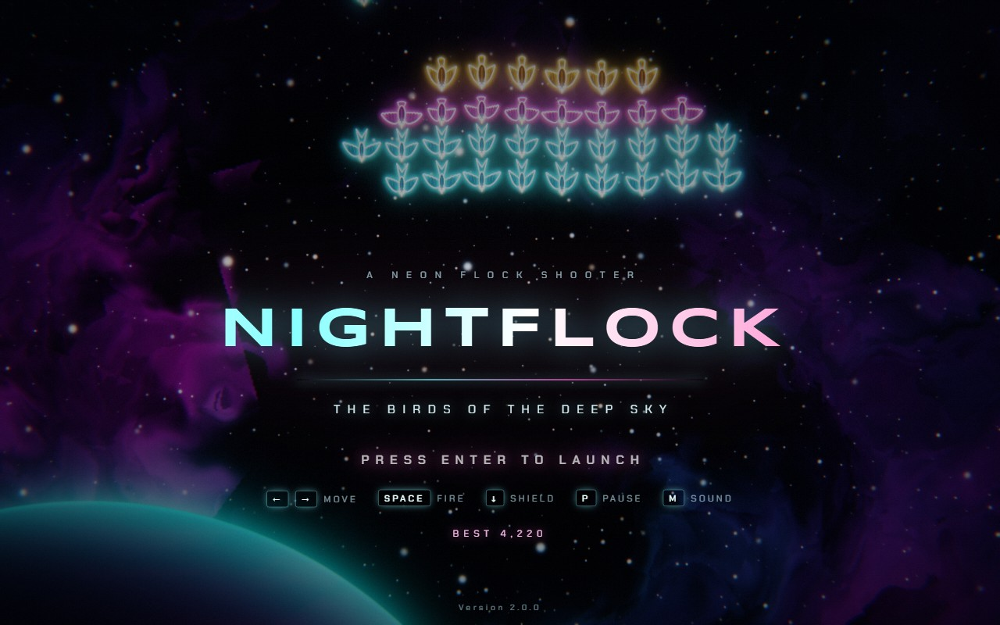

# Nightflock — Claude version

A bird shooter built with Claude (Anthropic), in the genre of *Phoenix* but with its
own theme and cast. Flocks dive at your ship, eggs hatch into great ravens whose wings
grow back, and every fourth wave a ship as wide as the screen comes down. A force
shield, used at the right moment, keeps you alive.

Graphics and sound are generated in the browser (WebGL 2 and Web Audio). There are no
image or audio files and no libraries.

**[Play it in your browser](https://iago-swi.github.io/phoenix/Claude/)**

The version number is shown on the title screen. The [changelog](CHANGELOG.md) lists
what changed in each version.

## Run it

Play online with the link above. To play offline, download [Nightflock.html](https://raw.githubusercontent.com/iago-swi/phoenix/main/Claude/Nightflock.html),
save it as an HTML file and open it in a current version of Chrome, Edge, Firefox or
Safari. That single file contains the whole game. To work on the source, clone the
repository and open this folder's `index.html`. No installation, build step or web
server is needed. The two typefaces load from Google Fonts; without an internet
connection the game falls back to system fonts.

## How to play

| Key | Action |
| --- | --- |
| `←` `→` or `A` `D` | Move |
| `Space` (or `↑`, `W`) | Fire. Hold it to keep firing |
| `↓` (or `S`, `Shift`) | Force shield |
| `Enter` or `Space` | Start, and start again after a game |
| `P` or `Esc` | Pause |
| `M` | Sound on/off |

With a mouse or on a touch screen, press and hold: the ship follows the pointer and
fires. The right mouse button, or a second finger, raises the shield.

**The force shield** lasts 1.8 seconds and then needs 5 seconds to recharge; the meter
at the bottom right shows it. While it is up, shots are absorbed and a bird that rams
it is destroyed, but the ship moves at a third of its speed and cannot fire.

The game runs in cycles of four waves. Each cycle is harder than the one before.

| Wave | What comes |
| --- | --- |
| 1 · Flock | Swallows, gulls and falcons hold formation and dive at you one after another. |
| 2 · Brood | Eggs drift from side to side and hatch into great ravens. |
| 3 · Storm | A second flock, in another formation, that dives more often. |
| 4 · The Aerie | A ship as wide as the screen, with armour, turrets and one red eye. |

| Target | Points | Notes |
| --- | --- | --- |
| Swallow (cyan) | 30 | Weaves from side to side as it dives. |
| Gull (magenta) | 50 | Turns sharply toward the ship. |
| Falcon (gold) | 80 | The fastest. Dives almost straight. |
| Egg | 40 | One shot breaks it. An egg left alone hatches. |
| Great raven (green, red eyes) | 200 | Only a hit on the body counts. |
| Raven's wing | 20 | Torn off by a shot. It grows back in about three seconds. |
| Armour plate of the Aerie | 10 | |
| The Aerie's eye | 100 per hit | Only while it is open. |
| The Aerie destroyed | 3000 × the cycle | |

A bird shot while it dives or swoops scores double. Kills in quick succession build a
chain: every third kill raises the multiplier by one, up to ×8, and the chain lapses
2.6 seconds after the last kill. Clearing a wave adds 500 points times the wave
number.

**Great ravens.** A raven that has lost a wing flies slowly and in circles and cannot
swoop. With both wings gone it tumbles down the screen until one grows back. Aim
between the wings.

**The Aerie.** Shoot a way through the armour below the eye, then hit the eye while
it is open. A closed eye turns shots away, and so does the hull. When the eye opens
it fires a fan of shots, the two turrets on the wings fire aimed shots, and the bays
at the wing tips release birds that gather under the wings and dive. The ship comes
down slowly as the fight goes on.

A great raven sometimes drops a power-up when it falls, and a diving bird
occasionally does. Fly through it to pick it up.

| Power-up | Effect |
| --- | --- |
| Twin | Two shots side by side, for 14 seconds. |
| Rapid | Fires twice as fast, with more shots in the air, for 12 seconds. |

You start with three ships. An extra ship comes at 15,000 points and then every
20,000 points, up to five. After a ship is lost, the next one cannot be hit for 2.6
seconds. A lost ship also loses its power-ups and the chain. The best score is kept
in the browser.

## Technical notes

### Stack

| | |
| --- | --- |
| Delivery | `index.html` plus four scripts in `js/`, about 1850 lines (100 KB) in total. `Nightflock.html` is the same game with the scripts inlined. No dependencies, no build step. |
| Language | Plain JavaScript (ES2020) in classic scripts, no framework. |
| Rendering | WebGL 2 (GLSL ES 3.00) for the whole scene and post-processing. HTML and CSS for the score bar, banners and screens. |
| Sound | Web Audio API. Every sound is synthesized; there are no audio files. |
| Type | Syncopate and Chakra Petch from Google Fonts, with system fallbacks. |
| Storage | `localStorage` only: `nightflock.best` (the best score). |
| Version | Written once, in `index.html` (the line shown on the title screen). Each version has a section in [CHANGELOG.md](CHANGELOG.md), a tag `nightflock-v…` and a release on GitHub; the rules are in [VERSIONING.md](../VERSIONING.md). |
| Requirements | A browser with WebGL 2. `EXT_color_buffer_float` is used for HDR render targets when present; otherwise the game falls back to 8-bit targets. |

| File | Responsibility |
| --- | --- |
| [js/gfx.js](js/gfx.js) | All shaders, render targets, the sprite batch and the frame pipeline. |
| [js/art.js](js/art.js) | Paints every sprite into one texture atlas when the game loads. |
| [js/sfx.js](js/sfx.js) | Sound effects and the soundtrack. |
| [js/game.js](js/game.js) | Waves, bird behavior, eggs, the Aerie, the ship and its shield, shots, scoring, particles, input, score bar and the frame loop. |
| [index.html](index.html) | Markup and CSS for the title, score bar, banners, pause and game-over screens. |
| [Nightflock.html](Nightflock.html) | Portable single-file edition. |
| [CHANGELOG.md](CHANGELOG.md) | What changed in each version. |

### The birds

No bird is an image file. When the game loads, `js/art.js` paints all sprites with
the Canvas 2D API into one 2048 × 2048 atlas, at twice their size on the playfield,
and uploads it as a texture with mipmaps.

The four species share one painting routine. Each is seen from above, beak pointing
down the screen, and is described by about 25 numbers: wingspan, where the wrist
bends, how far the tips sweep back, the number of feathers on the trailing edge, the
tail shape (forked, fan or wedge), body and head sizes and the colors. The raven adds
five splayed finger feathers at each wing tip. The trailing edge of a wing is a
quadratic curve cut into one scallop per feather.

A wingbeat is four frames. Seen from above, a raised wing looks shorter, so the
routine shrinks the wingspan by 22 to 32% and sweeps the tips back. Each species
beats at its own rate, from 6.5 frames per second for the raven to 13 for the
swallow.

Bodies and wings are nearly black and opaque. The wing fill stays dark for the inner
62 to 78% of the span and fades to color only at the tips; the outline is a thin
bright stroke. A soft glow in the species color is drawn behind each bird, and the
dark body blocks it, which gives the backlit silhouette.

The great raven is stored in pieces: its body, and one wing. The game draws the wing
twice, once mirrored, so that each side can be left out when it is shot off. A wing
that grows back is drawn smaller during the last 0.8 seconds and scaled up to full
size.

### Flocks and dives

The playfield is a fixed 800 × 900 space, scaled to fit the window and centered. A
flock is a grid of slots, 56 wide and 50 high, described by rows of letters. There
are three formations for the flock wave and two for the storm, used in turn from
cycle to cycle.

At the start of a wave the birds fly in from both sides, 75 ms apart, along cubic
Bézier curves that end at their slots. The whole formation sways 62 units to either
side and widens and narrows by 5%.

A dive has two phases. The bird first turns through half a loop away from the
formation, then steers toward the ship with a limited turn rate, on top of a
side-to-side weave whose size depends on the species. Once it is within 150 units
above the ship it stops steering, so a dive can be dodged at the last moment. A bird
that leaves the screen reappears at the top and flies back to its slot. When five
birds or fewer are left, they stop returning and dive again at once. The next diver
is drawn from the eight free birds closest to the edges and the bottom of the
formation.

| | Swallow | Gull | Falcon |
| --- | --- | --- | --- |
| Dive speed (units per second) | 235 | 295 | 360 |
| Turn rate (radians per second) | 2.2 | 3.0 | 1.6 |
| Shots per dive | 1 | 1 | 2 |
| Hit radius | 15 | 17 | 15 |

### Eggs and great ravens

A brood is six eggs in the first cycle and two more in each later cycle, up to
twelve. An egg moves on a sine curve across the width of the screen while bobbing up
and down. The first egg hatches after 4 to 5 seconds and each further egg about a
second later; an egg shakes and glows for the last 1.3 seconds. Touching an egg
costs a ship.

A great raven does not hold a slot. It steers toward a target point with a velocity
that eases toward the wanted direction, and picks a new point in the upper half of
the screen every 1.2 to 2.4 seconds. Every 2.5 to 5.5 seconds it swoops instead: the
target becomes a point just above the ship, it flies 1.6 times as fast and drops two
shots on the way down, then it climbs back. One raven swoops at a time in the first
cycle, two in the second and three from the third.

A shot is tested against the body first (a circle of radius 18) and then against the
two wings (radius 24, 37 units to either side of the body, turned with the bird). A
wing that is hit is gone for 3.2 seconds. With one wing a raven flies at 60% speed,
its velocity is turned toward the missing side a little every frame, so it circles,
and it cannot start a swoop. With no wings it stops steering and falls at 150 units
per second, spinning, until a wing is back.

### The Aerie

The Aerie is one sprite 700 units wide, with the armour plates, the eye and its lid
drawn on top. It enters from above, holds at first near the top and sinks about 3
units per second, sways 70 units to either side, and stops 330 units down.

A shot of the ship is converted into the Aerie's own space and tested from the bottom
up:

1. **Armour.** 65 plates in a grid of 13 by 5, each 21 × 13 units. A shot travels up
   to 16 units per frame, more than the height of a plate, so the test uses the
   segment the shot covered during the frame, not only the point where it ended.
2. **The eye.** Within 26 units of the center line a shot that clears the plates
   reaches the eye. It counts only while the lid is more than half open. The eye
   takes 12 hits in the first cycle and 4 more in each later one.
3. **The hull.** Everywhere else the shot is stopped by the underside of the hull.

The eye is open for 1.9 seconds and closed for 2.4 seconds (shorter in later cycles,
down to 1.4). Just over half a second after it opens it fires a fan of three shots at
the ship, five from the second cycle. Each wing turret fires an aimed shot every 1.5
to 2.5 seconds and glows brighter before it does. The bays release a swallow or a
gull every 3.4 seconds while fewer than four birds are out (more in later cycles, up
to seven); these escorts take up places under the wings and dive like the birds of a
flock.

When the eye is destroyed, all escorts and shots are cleared, explosions run along
the hull for 2.6 seconds and the ship breaks up.

### Difficulty

Everything scales with a level number: 1 for the flock of the first cycle, 2 for its
storm, then 3 and 4 in the second cycle, and so on.

| | Level 1 | Later |
| --- | --- | --- |
| Birds diving at once, at most | 2 | +1 every second level, and +1 in a storm, up to 7 |
| Pause between dives | 0.9 to 2.4 s | Shorter each level, down to 0.2 to 0.6 s; 30% shorter in a storm |
| Dive speed | As in the table above | +4.5% per level, up to level 13 |
| Speed of a bird's shot (units per second) | 311 | +11 per level, up to 450 |
| Shots per dive | As in the table above | One more from level 6 |

The ship may have three shots in the air, six with Rapid, and twice that with Twin.
A power-up drops from about one great raven in three and from one diving bird in
twenty, and picking one up scores 100. Running into a bird costs a ship.

### Rendering pipeline

Everything on the playfield is a textured quad from the atlas. Up to 14,000 quads are
written into one vertex buffer and drawn with a single call, in painter's order.
Blending is premultiplied (`ONE, ONE_MINUS_SRC_ALPHA`) and each quad carries an
"additive" value that scales its alpha: with alpha 0 a quad adds light, with alpha 1
it covers what is behind. Glows, sparks and the dark body of a bird go through the
same draw call. A quad with a negative width is drawn mirrored, which is how one wing
sprite serves both sides of a raven.

Each frame runs these passes:

1. **Nebula**, at half resolution. Five-octave value noise, domain-warped twice, and
   colored from a cosine palette. One hue number shifts the palette from wave to
   wave.
2. **Background**, at full resolution. The nebula, three layers of stars that scroll
   at different speeds, and the limb of a planet with banded clouds and a glowing
   atmosphere. Between waves the stars stretch into streaks.
3. **Sprites**, into the same target, a 16-bit float texture where colors may be
   brighter than white.
4. **Bloom.** A soft threshold (0.62), then six levels of downsampling and additive
   upsampling.
5. **Final grade.** Up to eight shockwave distortions, chromatic aberration, a
   vignette, the ACES tone curve and film grain.

Particles live in a ring buffer of 6000 entries, stored as typed arrays. A spark is
drawn as the soft glow sprite stretched along its velocity.

When a ship is lost, time slows to 16% and recovers over about a second, a large
shockwave bends the picture, and the color channels split for a moment.

The render resolution follows the device pixel ratio up to 2 and is capped at
2560 × 1440 pixels.

### Sound

A sequencer schedules sixteenth notes a quarter of a second ahead, polled every
60 ms, at about 103 beats per minute. The harmony is one bar each of A minor, F, C
and G. A pad of four detuned sawtooth oscillators and a sawtooth bass play
throughout; during play a kick, a noise hi-hat and a snare-like burst join in, with
random arpeggio notes through a feedback delay (0.36 s).

Each effect is a short recipe: the ship's shot is two oscillators whose pitch falls,
an explosion is white noise through a low-pass filter that sweeps down, a dive is a
falling sine tone with a 17 Hz wobble, and the shield is a rising sine tone with a
band of noise sweeping up.

### Title screen

The flock behind the title is the real game without a ship: the birds fly in, hold
formation and dive, but do not shoot.

### Behavior

- The game pauses when the window loses focus. While paused, nothing moves and
  nothing is added to the picture.
- Movement is multiplied by the time since the last frame, so the game plays at the
  same speed at 60 and at 120 frames per second.
- With `prefers-reduced-motion`, the title shimmer and the blinking prompts stop. The
  effects on the playfield (shake, shockwaves, color split) are not reduced.
- The best score of the game played online and of a downloaded `Nightflock.html` are
  kept separately, because a browser stores data per address.

### Testing

Adding `?wave=3` to the address starts a game at that wave; a game started this way
does not change the best score. `window.__nightflock` exposes the game state, the
ship, the birds, the eggs and the Aerie, and a function that destroys the Aerie.

The game was checked in Chrome with scripts that use both: a flock wave played by a
script that fires and moves from side to side; a brood wave, with eggs hatching and
wings shot off; the Aerie, where every hit on the eye was confirmed to land while it
was open; the shield going from ready to active to recharging and back; and the
sequence of waves 4 to 7, which runs through the end of one cycle and into the next.
On an Intel Arc 140V graphics chip at 1280 × 800 it ran at a steady 120 frames per
second. The screenshots were taken from such runs; for the first one the script moved
the ship and set the score.

Not checked: sound by ear, play on a real touch screen and with the right mouse
button, opening the files directly from disk, frame rate on slower graphics hardware,
and how hard the game is for a human player. No complete cycle has been played
through by hand.

[Game history and the other versions](../README.md)
