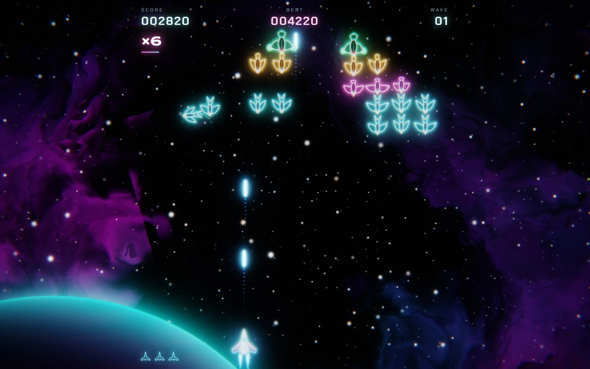

# Galaxian

A browser game inspired by the 1979 arcade game, built to compare what different AI assistants produce from the same brief. A swarm holds formation at the top of the screen, and one attacker after another breaks away to dive at your ship. The first version, by Claude, is here; versions by other assistants will follow, each in its own folder.

**Play it in your browser: <https://iago-swi.github.io/galaxian/>**

| Version | Play | Play offline | Source and technical notes |
| --- | --- | --- | --- |
| Claude · Nightflock | [Play](https://iago-swi.github.io/galaxian/Claude/) | [Download the standalone game](https://raw.githubusercontent.com/iago-swi/galaxian/main/Claude/Nightflock.html) | [Claude/](Claude/) |

To play offline, save the standalone file with the `.html` extension and open it in a browser, or download/clone this repository and open the root `index.html`, a landing page that links to every version. Each version is self-contained in its own folder, with its own README.

## Claude version



Use the arrow keys or `A` and `D` to move the ship, and hold **Space** to fire. With a mouse or on a touchscreen, press and hold: the ship follows the pointer and fires. Four kinds of bird dive at you, each in its own way, and a bird shot in mid-dive scores double. Kills in quick succession build a chain that multiplies the score up to eight times, and a fallen raven often drops twin shots, rapid fire or a shield. The best score is kept in the browser. Rules, scoring and technical notes are in [Claude/README.md](Claude/README.md).

## Game history

*Galaxian* reached Japanese arcades in September 1979. Namco built it as an answer to Taito’s *Space Invaders*, released the year before, and Midway brought it to North America in early 1980. The player’s ship, the Galaxip, moves along the bottom of the screen and can have only one shot in the air at a time. [Wikipedia](https://en.wikipedia.org/wiki/Galaxian)

What set it apart was the dive. The aliens do not simply march down the screen: they leave the formation and swoop at the player in curves. An alien shot during its attack scores double, and the flagship at the top is worth most when the red escorts that fly with it are shot first. [Arcade Archives](https://www.arcadearchives.com/en/title/aca-233/)

The cabinet was also a step forward in hardware. It was one of the first video games with RGB color graphics, and its tile-based system could show animated sprites in several colors over a scrolling field of stars. In Japan it was the second-highest-earning arcade game of 1979, behind *Space Invaders*. *Galaga* followed in 1981, *Gaplus* in 1984 and *Galaga ’88* in 1987. The original is still sold today, as part of the Arcade Archives series for [Nintendo Switch](https://www.nintendo.com/de-ch/Spiele/Nintendo-Switch-Download-Software/Arcade-Archives-GALAXIAN-2305901.html) and PlayStation 4. Videos of the game: [one](https://www.youtube.com/watch?v=n17VLD16huE) · [two](https://www.youtube.com/watch?v=ekxQlTIcKvw)

*Nightflock* keeps the formation and the dive and changes the cast. The attackers are birds seen from above, dark silhouettes edged in neon light: swallows, gulls, falcons and red-eyed ravens, a nod to Hitchcock’s *The Birds*. The ship may have three shots in the air instead of one. A bird shot in mid-dive still scores double, and a raven still brings escorts, but the formations change from wave to wave and ravens drop power-ups.

## Releases

Each game is numbered separately and has its own release notes. The [Releases page](https://github.com/iago-swi/galaxian/releases) lists every numbered release, with the standalone game of that release attached where there is one. The numbering rules are in [VERSIONING.md](VERSIONING.md).

| Game | Release notes |
| --- | --- |
| Nightflock | [Claude/CHANGELOG.md](Claude/CHANGELOG.md) |

## Repository structure

```text
galaxian/
├── Claude/        Nightflock: game, source, screenshots and technical notes
├── index.html     Landing page that links to every version
├── VERSIONING.md  How the games are numbered and released
└── README.md
```

Personal fan project, not affiliated with the makers of the original game.
